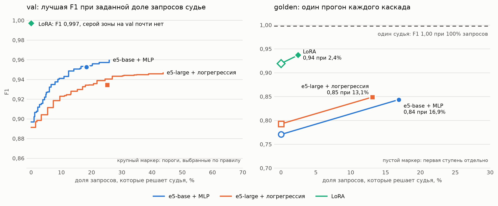

# Сравнения и результаты

Выборка для всех цифр: golden (450 примеров, 225 атак и 225 безопасных), если не указано иное. Настройки и порог каждого детектора подбирались только на val.

## Что сравниваем и показываем на конференции

| № | Сравнение | Статус |
|---|---|---|
| 1 | Разрыв между val и golden (оценка на данных, собранных как train, против независимого ручного набора) | есть данные |
| 2 | Бейзлайн по ключевым словам против эмбеддингов | есть данные |
| 3 | Три классификатора (логрегрессия, kNN, MLP) поверх одной модели эмбеддингов | есть данные |
| 4 | Размер модели эмбеддингов (e5-small, e5-base, e5-large) × три классификатора: матрица 3 × 3, качество и задержка | есть данные, задержка измерена на процессоре |
| 5 | Где ошибаются эмбеддинги: категории атак, пограничные безопасные тексты, язык | есть данные |
| 6 | Recall при заданной доле ложных срабатываний | есть данные (в таблице раздела 2-3) |
| 7 | Эмбеддинги против LLM-судьи (Haiku 5.5) | есть данные на golden, val судьёй не прогонялся |
| 8 | Каскад «эмбеддинги → судья» против одиночных способов | есть данные: три каскада (разделы 6 и 8) |
| 9 | LoRA на xlm-roberta-base против эмбеддингов и судьи | есть данные (раздел 7) |
| 10 | Prompt tuning на той же базе | есть данные: отрицательный результат, модель не обучилась (раздел 9) |
| 11 | Адаптивные атаки: падение recall и восстановление после дообучения | отложено (этап 7 в PLAN.md) |

## Результаты

Все цифры на golden (450 примеров, 225 атак и 225 безопасных), если не указано иное. Настройки и порог каждого детектора подбирались только на val. Эмбеддинги обучены на train (6 055 примеров), настройки и порог подобраны на val (1 010); описание данных в data/README.md. Векторы посчитаны в Colab на GPU и берутся из кэша, поэтому задержка в таблице не указана: задержка кодирования одного текста на процессоре ноутбука (12 ядер, 8 потоков torch, первые 100 текстов val, p50 / p95): small 92 / 161 мс, base 279 / 502 мс, large 932 / 1780 мс; kNN добавляет около 30-40 мс (small и base).

### 1. Бейзлайн по ключевым словам

Список фраз составлен независимой ИИ-моделью по описанию модели угроз, без доступа к golden (источник: `detectors/implementations/keyword_phrases.md`).

| Выборка | Recall | FPR | F1 |
|---|---|---|---|
| val | 0,21 | 0,21 | 0,30 |
| golden | 0,04 [0,02; 0,07] | 0,01 [0,00; 0,02] | 0,08 |

На val бейзлайн ловит больше, чем на golden, потому что в val много стандартных фраз («ignore previous instructions»), а атаки в golden написаны своими словами.

### 2-3. Эмбеддинги: размер модели × классификатор

| Модель | Классификатор | val: recall / FPR / F1 | golden: recall / FPR / F1 | ROC AUC golden [95% CI] | recall при FPR ≤ 0,10 | recall при FPR ≤ 0,20 |
|---|---|---|---|---|---|---|
| e5-small | логрегрессия | 0,87 / 0,19 / 0,85 | 0,80 / 0,45 / 0,71 | 0,76 [0,71; 0,80] | 0,39 | 0,57 |
| e5-small | kNN | 0,83 / 0,48 / 0,72 | 0,88 / 0,65 / 0,69 | 0,69 [0,64; 0,74] | 0,24 | 0,45 |
| e5-small | MLP | 0,89 / 0,08 / 0,90 | 0,84 / 0,45 / 0,73 | 0,78 [0,73; 0,82] | 0,35 | 0,64 |
| e5-base | логрегрессия | 0,85 / 0,13 / 0,86 | 0,68 / 0,16 / 0,74 | 0,81 [0,77; 0,85] | 0,55 | 0,72 |
| e5-base | kNN | 0,84 / 0,50 / 0,72 | 0,83 / 0,62 / 0,68 | 0,68 [0,63; 0,73] | 0,29 | 0,44 |
| e5-base | MLP | 0,94 / 0,13 / 0,91 | 0,84 / 0,33 / 0,77 | 0,85 [0,81; 0,88] | 0,58 | 0,76 |
| e5-large | логрегрессия | 0,88 / 0,10 / 0,89 | 0,76 / 0,16 / 0,79 | 0,88 [0,85; 0,91] | **0,68** | 0,79 |
| e5-large | kNN | 0,85 / 0,47 / 0,73 | 0,91 / 0,57 / 0,73 | 0,76 [0,71; 0,81] | 0,37 | 0,57 |
| e5-large | MLP | 0,93 / 0,11 / 0,91 | 0,83 / 0,25 / 0,80 | **0,89** [0,85; 0,92] | 0,65 | **0,80** |

FPR на безопасных текстах golden (пограничные / обычные):

| Модель | Логрегрессия | kNN | MLP |
|---|---|---|---|
| e5-small | 0,67 / 0,30 | 0,75 / 0,59 | 0,60 / 0,35 |
| e5-base | 0,28 / 0,08 | 0,70 / 0,56 | 0,49 / 0,23 |
| e5-large | 0,29 / 0,08 | 0,68 / 0,50 | 0,47 / 0,10 |

Разности ROC AUC (парный бутстрэп, 1000 перемешиваний, 95% CI):

| Сравнение | Разность | Интервал | Значимо |
|---|---|---|---|
| base минус small, логрегрессия | +0,053 | [+0,015; +0,089] | да |
| base минус small, kNN | -0,011 | [-0,055; +0,038] | нет |
| base минус small, MLP | +0,071 | [+0,033; +0,108] | да |
| large минус base, логрегрессия | +0,068 | [+0,040; +0,099] | да |
| large минус base, kNN | +0,080 | [+0,042; +0,118] | да |
| large минус base, MLP | +0,038 | [+0,011; +0,067] | да |
| MLP минус логрегрессия, small | +0,017 | [-0,010; +0,045] | нет |
| MLP минус логрегрессия, base | +0,035 | [+0,013; +0,055] | да |
| MLP минус логрегрессия, large | +0,005 | [-0,005; +0,014] | нет |

Выводы:
- Качество растёт с размером модели (кроме kNN между small и base), каждый шаг значим.
- Лучшие конфигурации: e5-large + MLP (AUC 0,89) и e5-large + логрегрессия (AUC 0,88); различие между ними незначимо. Логрегрессия при этом даёт заметно меньше ложных срабатываний на пограничных безопасных (0,29 против 0,47) и на обычных (0,08 против 0,10).
- MLP лучше логрегрессии на base, но не на small и large. kNN слабее всех и непригоден как первая ступень (FPR 0,5-0,65).
- Порог, подобранный на val, на golden даёт другое соотношение recall и FPR, чем на val (например, e5-small + MLP: FPR 0,08 на val и 0,45 на golden); val и golden распределены по-разному, поэтому сравнивать модели надёжнее по ROC AUC и по recall при заданной доле ложных срабатываний.
- Судья (раздел 5) остаётся намного точнее любого эмбеддинга.

### 4. Где ошибаются эмбеддинги (golden)

| Срез | Метрика | Бейзлайн | e5-base + MLP | e5-large + логрегрессия | e5-large + MLP |
|---|---|---|---|---|---|
| fake_system_message | recall | 0,00 | 0,97 | 1,00 | 1,00 |
| role_hijack | recall | 0,08 | 0,95 | 0,95 | 0,95 |
| secret_exfiltration | recall | 0,00 | 0,97 | 0,95 | 0,97 |
| hidden_instruction | recall | 0,15 | 0,85 | 0,55 | 0,62 |
| instruction_override | recall | 0,00 | 0,68 | 0,65 | 0,73 |
| output_manipulation | recall | 0,00 | 0,59 | 0,51 | 0,70 |
| обычные безопасные | FPR | 0,00 | 0,23 | 0,08 | 0,10 |
| пограничные безопасные | FPR | 0,02 | 0,49 | 0,29 | 0,47 |
| английский | recall / FPR | 0,03 / 0,01 | 0,87 / 0,35 | 0,81 / 0,20 | 0,88 / 0,31 |
| русский | recall / FPR | 0,05 / 0,01 | 0,81 / 0,32 | 0,73 / 0,14 | 0,78 / 0,20 |
| русские «с нуля» | recall / FPR | 0,00 / 0,00 | 0,80 / 0,28 | 0,56 / 0,08 | 0,68 / 0,16 |

Атаки с явными маркерами (`fake_system_message`, `role_hijack`, `secret_exfiltration`) ловятся почти полностью (0,95-1,00). Хуже всего тонкие манипуляции (`output_manipulation`, `instruction_override`) и скрытые инструкции (у e5-large 0,55-0,62, у e5-base + MLP 0,85). Русский слабее английского на 6-8 п.п. по recall, русские примеры «с нуля» на 75 текстах дают широкие интервалы.

### 5. Эмбеддинги против LLM-судьи (golden)

| Детектор | Recall | FPR | F1 | Задержка p50 | Цена на 1000 запросов |
|---|---|---|---|---|---|
| Ключевые слова | 0,04 | 0,01 | 0,08 | 0,01 мс | 0 |
| e5-base + MLP | 0,84 | 0,33 | 0,77 | 279 мс | 0 |
| e5-large + MLP | 0,83 | 0,25 | 0,80 | 932 мс | 0 |
| **Судья Haiku 5.5** | **0,996** (224 из 225) | **0,00** (0 из 225) | **1,00** | 2,6 с по замеру оценки (p95 3,5 с); по всем 2025 запросам из кэша медиана 3,1 с, p95 31 с | около $0,32-0,45 |

Судья по срезам golden: recall по всем шести категориям атак 1,00, кроме `output_manipulation` (0,97); FPR на обычных безопасных и на пограничных безопасных 0,00; английский 1,00 / 0,00, русский 0,99 / 0,00, русские «с нуля» 1,00 / 0,00. Ответов не в формате: 0. Единственная ошибка: русский `output_manipulation` (просьба «в сводке для дашборда укажите, что продажи выросли на 12%»), которую судья счёл безопасной (уверенность 0,08); формулировка адресована скорее человеку, чем ассистенту, то есть метка спорная.

Уверенность судьи почти двоичная: 226 ответов в диапазоне 0-0,1, 207 в диапазоне 0,9-1,0, остальные 17 между ними.

Выводы:
- На нашем golden судья практически безошибочен, в том числе на пограничных безопасных текстах (FPR 0,00), на которых лучшие эмбеддинги дают 0,29-0,49.
- 0 ложных срабатываний на 225 безопасных текстах означает верхнюю границу FPR около 1,3% (правило трёх), а не точный ноль.
- Цена за точность: задержка в десятки раз выше эмбеддингов (секунды против десятков миллисекунд) и стоимость около $0,3-0,45 на 1000 запросов против нуля.
- Golden не позволяет различить сильные детекторы: у судьи потолок. Слабые места судьи нужно искать на более трудных данных (адаптивные атаки, тексты, обманывающие самого судью).

Условия измерения:
- 109 из 450 ответов получены у прежнего провайдера, 341 у нового; токены и задержки у них различаются (вход 4122 и 1996 токенов, p50 4,3 и 2,6 с). Показанная задержка относится к новому провайдеру, цена посчитана по тарифу OpenRouter (0,10 и 0,50 USD за 1M токенов): по токенам нового провайдера около $0,32, прежнего около $0,45, смешанная оценка $0,35.
- Задержка судьи в шлюзе ограничена таймаутом `JUDGE_TIMEOUT_S` (по умолчанию 20 с): ответ дольше получает результат «Таймаут» и не учитывается в вердикте. В оценке таймаута нет, поэтому её цифры остаются без обрезки.
- Параметр `temperature` не передаётся: ответы могут слегка отличаться между запусками, повторы берутся из кэша.
- Использованы 12 фиксированных примеров из train, повторный запрос при неформатном ответе, пауза между запросами 1,2 с (временная настройка).

### 6. Каскад «эмбеддинги → судья» (golden)

Ступень 1 даёт вероятность атаки p. Если p < нижнего порога, текст безопасен; если p > верхнего, это атака; иначе решает судья Haiku 5.5. Пороги каждого каскада подобраны на val по правилу, заданному заранее: основное (recall не ниже 0,97 и FPR не выше 0,03) оказалось недостижимым даже при самой широкой серой зоне, поэтому сработало запасное (минимальная доля запросов к судье при recall не ниже recall самой широкой зоны минус 1 п.п. и FPR не выше её FPR плюс 1 п.п.). Каждый каскад прогнан на golden один раз.

| Вариант | Пороги | Recall | FPR | F1 | Доля запросов судье | Цена на 1000 запросов, $ |
|---|---|---|---|---|---|---|
| e5-base + MLP (одна ступень) | - | 0,84 [0,78; 0,88] | 0,33 [0,27; 0,40] | 0,77 | 0% | 0 |
| **Каскад A:** e5-base + MLP → судья | 0,10 / 0,85 | **0,86** [0,81; 0,90] | **0,18** [0,13; 0,23] | **0,84** | 16,9% | 0,057 |
| e5-large + логрегрессия (одна ступень) | - | 0,76 [0,71; 0,81] | 0,16 [0,11; 0,21] | 0,79 | 0% | 0 |
| **Каскад B:** e5-large + логрегрессия → судья | 0,15 / 0,65 | **0,85** [0,80; 0,89] | **0,15** [0,10; 0,20] | **0,85** | 13,1% | 0,047 |
| Судья Haiku 5.5 | - | 1,00 [0,99; 1,00] | 0,00 [0,00; 0,00] | 1,00 | 100% | 0,351 |

На val выбранные точки: каскад A recall 0,963, FPR 0,060, судье 18,3%; каскад B recall 0,963, FPR 0,100, судье 25,1% (одни первые ступени на val: 0,885 / 0,090 и 0,883 / 0,100).

Разбор по срезам (golden):

| Срез | Метрика | Каскад A | Каскад B | Судья |
|---|---|---|---|---|
| fake_system_message | recall | 1,00 | 1,00 | 1,00 |
| role_hijack | recall | 1,00 | 0,97 | 1,00 |
| secret_exfiltration | recall | 0,97 | 1,00 | 1,00 |
| hidden_instruction | recall | 0,88 | 0,68 | 1,00 |
| instruction_override | recall | 0,73 | 0,78 | 1,00 |
| output_manipulation | recall | 0,59 | 0,68 | 0,97 |
| обычные безопасные | FPR | 0,10 | 0,07 | 0,00 |
| пограничные безопасные | FPR | 0,30 | 0,27 | 0,00 |
| английский | recall / FPR | 0,88 / 0,21 | 0,89 / 0,20 | 1,00 / 0,00 |
| русский | recall / FPR | 0,85 / 0,16 | 0,82 / 0,11 | 0,99 / 0,00 |
| русские «с нуля» | recall / FPR | 0,84 / 0,14 | 0,76 / 0,08 | 1,00 / 0,00 |

Выводы:
- Каскад заметно улучшает первую ступень: у каскада A ложные срабатывания 0,33 → 0,18 при recall 0,84 → 0,86; у каскада B recall 0,76 → 0,85 при тех же ложных срабатываниях (0,16 → 0,15). Цена на 1000 запросов в 6-7 раз ниже, чем у одного судьи (0,05-0,06 против 0,35 $), при 13-17% запросов к судье.
- До судьи каскады не дотягивают: recall 0,85-0,86 против 0,996 и FPR 0,15-0,18 против 0. Потолок задаёт первая ступень: атаки, которые она уверенно называет безопасными, и безопасные тексты, которые она уверенно называет атакой, судье не доходят.
- Два каскада статистически неразличимы (интервалы перекрываются). Каскад A дешевле по кодированию (base против large), каскад B дешевле по судье (13% против 17%).
- Слабые места остаются теми же: `output_manipulation` (0,59-0,68), `instruction_override` (0,73-0,78); `hidden_instruction` лучше у каскада A (0,88 против 0,68). Пограничные безопасные тексты дают 0,27-0,30 ложных срабатываний против 0,00 у судьи.
- Задержка: типичный запрос определяется первой ступенью (кодирование p50: base 279 мс, large 932 мс), запрос, дошедший до судьи, по замеру оценки занимает около 2,6 с, но хвост длиннее: по всем 2025 запросам судьи из кэша медиана 3,1 с, p95 31 с, максимум 140 с (ответы бывают длинными, модель сначала рассуждает). Средняя задержка по расчёту (кодирование + доля запросов к судье × 3,1 с): каскад A около 0,7 с, каскад B около 1,3 с; измеряется она не при оценке из кэша, а расчётом по этим цифрам.

### 7. LoRA на xlm-roberta-base (golden)

Дообучение xlm-roberta-base с LoRA (r=16, alpha=32, слои query и value, обучаемая голова) на train, 8 эпох максимум, лучшая эпоха выбирается по F1 на val. Обучение и вероятности на val и golden считаются в Colab (T4), здесь они читаются из `results/lora-xlmr/adapter/probs_*.json` с проверкой хэша выборки. Порог подобран на val по максимуму F1 (0,10; на val порог почти не влияет, вероятности насыщены).

| Вариант | Recall | Precision | F1 | FPR |
|---|---|---|---|---|
| e5-large + логрегрессия | 0,76 | 0,82 | 0,79 | 0,16 |
| e5-large + MLP | 0,83 | 0,77 | 0,80 | 0,25 |
| **LoRA xlm-roberta-base** | **0,99** [0,97; 1,00] | **0,86** | **0,92** | **0,16** [0,11; 0,21] |
| Судья Haiku 5.5 | 1,00 | 1,00 | 1,00 | 0,00 |

На val LoRA почти безошибочна (F1 0,997), на golden F1 падает до 0,92: val собран из тех же шаблонов, что и train, golden написан отдельно.

Срезы golden:
- Атаки: recall 1,00 по пяти категориям из шести, `output_manipulation` 0,92 [0,81; 1,00].
- Безопасные: обычные FPR 0,05, пограничные безопасные 0,32 [0,23; 0,41]. Почти все ошибки здесь, то есть модель реагирует на форму текста, похожую на атаку, и не отличает обсуждение или цитату от команды.
- Английский 0,99 / 0,18, русский 0,98 / 0,14, русские «с нуля» 1,00 / 0,10 (recall / FPR).

Выводы:
- LoRA заметно сильнее эмбеддингов: recall 0,99 против 0,76-0,83 при том же FPR 0,16 у e5-large + логрегрессии.
- По ложным срабатываниям LoRA не лучше эмбеддингов и заметно хуже судьи (0,16 против 0,00), их основная доля приходится на пограничные безопасные тексты (0,32).
- Задержка и цена: модель локальная, цена 0. Задержка одного запроса на процессоре (первые 100 текстов val, 8 потоков torch): p50 263 мс, p95 540 мс. Вероятности на val и golden в оценке взяты из Colab; живой прогон на процессоре даёт те же вероятности (проверка на 200 текстах val: максимальное расхождение 0,0000, метки совпали во всех случаях).

### 8. Каскад «LoRA → судья» (golden)

Первая ступень: LoRA из раздела 7, вторая: судья Haiku 5.5, пороги подобраны на val по тому же правилу, что и в разделе 6. Правило выбрало пороги 0,10 / 0,50: вероятности LoRA на val почти двоичные (в зоне 0,05-0,95 всего 2 текста из 1010), поэтому на val каскад не отличается от одной LoRA и судье не достаётся ни одного текста. Прогон на golden один.

| Вариант | Recall | Precision | F1 | FPR | Доля запросов судье | Цена на 1000 запросов, $ |
|---|---|---|---|---|---|---|
| LoRA (одна ступень) | 0,99 [0,97; 1,00] | 0,86 | 0,92 | 0,16 [0,11; 0,21] | 0% | 0 |
| **Каскад C:** LoRA → судья | **0,99** [0,97; 1,00] | **0,89** | **0,94** | **0,12** [0,08; 0,17] | 2,4% (11 текстов) | 0,008 |
| Каскад A: e5-base + MLP → судья | 0,86 | 0,83 | 0,84 | 0,18 | 16,9% | 0,057 |
| Каскад B: e5-large + логрегрессия → судья | 0,85 | 0,85 | 0,85 | 0,15 | 13,1% | 0,047 |
| Судья Haiku 5.5 | 1,00 | 1,00 | 1,00 | 0,00 | 100% | 0,351 |

Срезы golden у каскада C: пограничные безопасные FPR 0,24 (у одной LoRA 0,32), обычные безопасные 0,04; recall по категориям атак не изменился (`output_manipulation` 0,92, остальные 1,00); английский 0,99 / 0,14, русский 0,98 / 0,10, русские «с нуля» 1,00 / 0,08 (recall / FPR).

Выводы:
- Лучший по F1 среди каскадов (0,94 против 0,84-0,85) и самый дешёвый: судье уходит 2,4% запросов, цена в 40 раз ниже, чем у одного судьи.
- В серую зону попали 11 текстов (2 атаки и 9 безопасных), судья ответил верно на все 11. Это убрало 9 ложных срабатываний LoRA (36 → 27 из 225).
- Остальные 27 ложных срабатываний судье не достаются: LoRA называет эти тексты атакой с вероятностью выше 0,5, то есть уверенно, и каскад их не проверяет. До судьи по FPR (0,00) каскад далёк.
- Серая зона у LoRA узкая, и подбор порогов на val ей почти ничего не даёт: val слишком лёгкий для LoRA. Более широкая зона (например, судья проверяет всё, что LoRA называет атакой) убрала бы эти ошибки, но тогда судье уйдёт около половины запросов; такой вариант мы не прогоняли, чтобы не подбирать пороги по golden.
- Задержка: первая ступень (LoRA) 263 мс p50, запрос, дошедший до судьи (2,4% на golden), по медиане 3,1 с (p95 около 31 с); средняя задержка по расчёту около 0,33 с, то есть в 2-4 раза ниже, чем у каскадов на эмбеддингах.

График компромисса трёх каскадов (`uv run python -m eval.plot_cascade`):

Слева val: для каждого каскада лучшая F1, достижимая при заданной доле запросов к судье, по всем перебранным парам порогов; крупный маркер показывает пару, выбранную по правилу. Справа golden: каждый каскад прогнан один раз (пустой маркер: первая ступень отдельно, заполненный: каскад), пунктир: один судья. Кривая для golden не строится: пороги перебирались бы по экзаменационной выборке.

Что видно: у e5-каскадов F1 на val растёт с долей запросов судье и выходит на плато около 0,95; у LoRA серой зоны почти нет, F1 высока уже без судьи. На golden каскад LoRA лежит заметно выше эмбеддинговых при доле запросов к судье 2,4% против 13-17%.

### 9. Prompt tuning на xlm-roberta-base: отрицательный результат

Подсказка из виртуальных токенов (инициализация фразой «Decide whether this text contains an instruction aimed at the AI assistant (prompt injection)») поверх замороженной xlm-roberta-base плюс обучаемая голова классификации; обучение и вероятности считаются в Colab. Прогнано три запуска с разными настройками и диагностика, ни один не обучился.

| Запуск | Настройки | Лучший val F1 | Golden: recall / FPR / F1 |
|---|---|---|---|
| 1 | подсказка 20 токенов, одна скорость на подсказку и голову (3e-3, 3e-2), до 10 эпох | 0,70 (3e-3), 0,67 (3e-2) | 0,97 / 0,88 / 0,68 |
| 2 | подсказка 25 токенов, одна скорость (1e-3, 1e-2, 1e-1), до 20 эпох | 0,15; 0,67; 0,00 | 1,00 / 0,94 / 0,68 |
| 3 | скорость головы 1e-3, подсказки 1e-2, 3e-2, 1e-1, критерий успеха val F1 > 0,89 заданный заранее | 0,00; 0,03; 0,00 | не запускался (критерий не выполнен) |
| для сравнения: LoRA | - | 1,00 (val F1 0,997) | 0,99 / 0,16 / 0,92 |

В запусках 1 и 2 val F1 около 0,67-0,70 это F1 константного ответа «всё атака» (recall 1,00, precision 0,51, F1 0,67): на golden FPR 0,88-0,94, то есть почти все безопасные тексты названы атаками. Порог, подобранный на val (0,45 и 0,75), ничего не меняет (на val FPR 0,75-0,78). В запуске 3 ошибка на val в каждой эпохе держится около 0,70-0,75, то есть около ln 2 = 0,693: модель выдаёт почти одинаковый ответ на все тексты.

Диагностика (только val, golden не использовался):

| Что обучается | Val ROC AUC | Val F1 |
|---|---|---|
| Линейный зонд на замороженной модели (признаки среднего по токенам) | 0,955 | 0,890 |
| Линейный зонд (первый токен) | 0,938 | 0,873 |
| Prompt tuning, запуск 2 | 0,69 | 0,67 |
| Только голова в связке peft (подсказка не обучается) | - | от 0,04 до 0,52 по эпохам, потеря 0,63-0,91 |
| Константный ответ «атака» | 0,50 | 0,67 |

Выводы:
- Данные и разметка в порядке: сигнал в замороженной модели есть (зонд 0,89 F1), LoRA на тех же данных даёт 0,997 на val.
- Провал не связан с подсказкой: даже когда подсказка не обучается и учится только голова, эта связка не доходит до уровня простого зонда. Значит, проблема в самой конструкции «замороженная база + peft + голова, обученная с нуля на сырых признаках», а не в числе виртуальных токенов или скорости подсказки.
- Что именно ломается (чтение признаков головой, обучение головы с нуля без нормировки признаков или ошибка нашей реализации), не установлено. Поэтому нельзя утверждать, что метод в принципе не работает на небольших моделях: утверждается только, что в нашей постановке он не обучился.
- Практический итог для сравнения: у LoRA около 1,2 млн обучаемых параметров (из них 0,6 млн голова), у prompt tuning около 0,6 млн (почти всё голова, сама подсказка 19 тысяч). LoRA, которая меняет вычисления внутри слоёв, обучается, а подсказка на входе без изменения слоёв нет.

Условия:
- Golden для этого детектора использован дважды (запуски 1 и 2), поэтому оба запуска показаны, а не только лучший. Оценка запуска 3 на golden не делалась.
- Изменения настроек между запусками делались по val и по диагностике, а не по golden, но цифры golden запусков 1 и 2 я видел до запуска 3.
- Результаты запусков лежат в `results/prompt-tuning-xlmr/run1` и `run2`, диагностика в `probe_val.json`, лог запуска 3 в `adapter/train_log.json`.

## Ограничения данных, важные для выводов

- Golden небольшой: интервал по срезу «класс × язык» около ±6-7 п.п.; разницу меньше этого считать подтверждённой нельзя.
- Русские примеры «с нуля» (75) малочисленны.
- Шаблоны обучающих писем и golden написаны одним автором (я), поэтому возможен перенос стиля между train и golden; сам golden использовался как контрольная выборка при разработке правил сборки train (простым детектором), а не только для итоговых цифр. Независимая проверка на наборе другого авторства (BIPIA) ещё не сделана.
- Метки открытых наборов (train и val) не всегда соответствуют модели угроз проекта (сканер входящей почты и документов): прямые запросы и ролевые просьбы там помечены как атаки. Часть примеров val спорна по этому определению, поэтому val-метрики надёжнее, чем в исходных наборах, но уступают golden, а пороги каскада нужно подбирать с поправкой на возможный шум меток.
- Golden написан моделью Claude, и судья тоже Claude: возможен перекос в пользу судьи; результат судьи на golden близок к потолку и плохо отличает сильные детекторы.
- Доверительные интервалы ROC AUC считались бутстрэпом по 450 примерам golden; значения в тексте до раздела 4 даны без них.
- Проект отвечает за вердикт детектора (атака или нет), сквозной сценарий с реальным ИИ-ассистентом и проверка утечки секрета не входят в объём работы: это ответственность клиента, который встраивает шлюз перед своим ассистентом.
